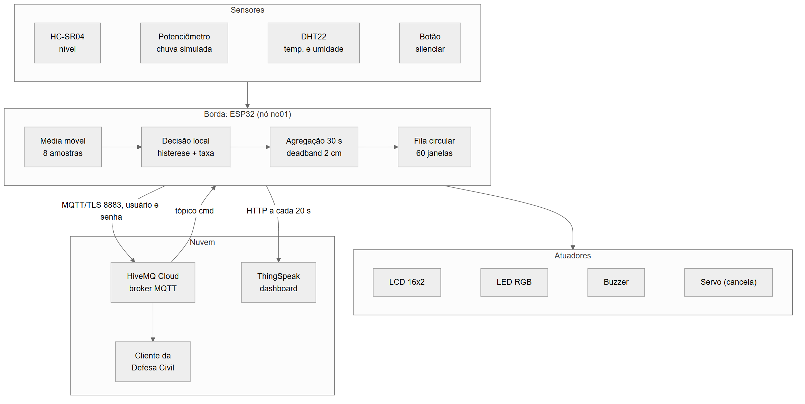
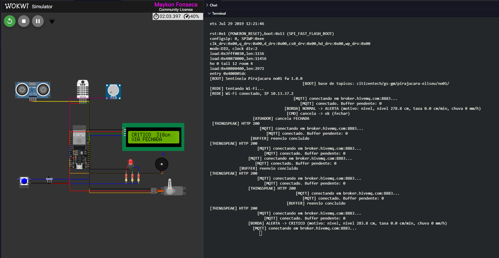

# Sentinela Pirajuçara

Nó de borda com ESP32 que monitora o nível do córrego Pirajuçara sob uma ponte da região da Av. Eliseu de Almeida (São Paulo), decide localmente o risco de alagamento, avisa quem está passando (LCD, LED RGB e sirene) e fecha a cancela da ponte quando o nível fica crítico, mesmo sem rede. Os dados agregados e os eventos seguem para o broker público da HiveMQ (MQTT com TLS) e para um dashboard no ThingSpeak.

Projeto da Global Solution 2026.2 (CitizenTech) da disciplina de Edge Computing, Ciência da Computação, FIAP.

## Integrantes

| Nome | RM | E-mail |
|---|---|---|
| Gustavo Franzoti Gonçalves | RM566983 | RM566983@fiap.com.br |
| Maykon Santana Fonseca | RM567041 | RM567041@fiap.com.br |

## Tecnologias

- ESP32 DevKit C v4 simulado no VS Code com as extensões PlatformIO IDE e Wokwi Simulator, firmware em C++ (Arduino)
- Sensores: HC-SR04 (nível), potenciômetro simulando pluviômetro, DHT22, botão
- Atuadores: LCD 16x2 I2C, LED RGB, buzzer, servo (cancela)
- MQTT: broker público da HiveMQ (`broker.hivemq.com`, porta 8883 com TLS), bibliotecas PubSubClient e ArduinoJson 7, acompanhamento pelo [MQTT WebSocket Client](https://www.hivemq.com/demos/websocket-client/)
- Dashboard: ThingSpeak (REST/HTTP)
- Diagramas em Mermaid; relatório gerado com python-docx e exportado pelo Word

## Estrutura de pastas

```
firmware/                 projeto PlatformIO
  src/main.cpp            sensores, atuadores, MQTT, reconexão, buffer, ThingSpeak
  include/borda.h         lógica de borda (filtro, histerese, antecipação, fila circular)
  include/secrets.exemplo.h  modelo de credenciais (o secrets.h real fica fora do git)
  test/test_borda.cpp     testes da lógica de borda que rodam no PC
  diagram.json            circuito do Wokwi
  wokwi.toml              liga o Wokwi ao firmware compilado
  .vscode/extensions.json extensões recomendadas (PlatformIO e Wokwi)
docs/
  diagramas/*.mmd         fontes Mermaid
  img/*.png               diagramas exportados
  prints/                 capturas de tela usadas no relatório
  links.json              links do vídeo e do repositório
  gerar_relatorio.py      gera o DOCX e o PDF do relatório
  Relatorio_GS_EdgeComputing_SentinelaPirajucara.pdf
scripts/empacotar.py      gera o .zip do PlatformIO para a entrega
```

## Como executar

### 1. Credenciais

1. O plano gratuito HiveMQ Cloud Serverless foi descontinuado (não aceita novos clusters e os existentes são apagados em 31/12/2026). Por isso o projeto usa o broker público `broker.hivemq.com`, que não precisa de conta. Os comandos são protegidos por um token definido no `secrets.h` (`TOKEN_COMANDO`).
2. No ThingSpeak, crie um canal com os campos 1 a 8 (nível, chuva, temperatura, umidade, estado, taxa de subida, mensagens evitadas, buffer) e copie a *Write API Key*.
3. Copie o modelo e preencha `TOKEN_COMANDO` (um valor só do grupo) e `THINGSPEAK_WRITE_KEY`:

```bash
cp firmware/include/secrets.exemplo.h firmware/include/secrets.h
```

### 2. Preparar o VS Code

1. Instale as extensões **PlatformIO IDE** e **Wokwi Simulator** (o VS Code sugere as duas ao abrir a pasta, por causa do `.vscode/extensions.json`).
2. Abra a pasta **`firmware`** em *File → Open Folder*. Ela precisa ser a raiz do workspace, porque é ali que ficam o `platformio.ini` e o `wokwi.toml`.
3. Ative a licença gratuita do Wokwi: `F1` → **Wokwi: Request a New License** e confirme no navegador.

### 3. Compilar e simular

```bash
pio run
```

(ou o botão ✓ *Build* na barra do PlatformIO). Depois, `F1` → **Wokwi: Start Simulator**. O `wokwi.toml` aponta para `.pio/build/esp32dev/firmware.bin`, então toda alteração no código precisa de um novo build antes de reiniciar a simulação. O monitor serial aparece no painel inferior do VS Code e o circuito no `diagram.json`.

### 4. Testar no simulador

- Arraste a distância do HC-SR04 para baixo: 200 cm → nível 150 cm (ATENCAO), 130 cm → 220 cm (ALERTA), 70 cm → 280 cm (CRITICO, cancela fecha).
- Gire o potenciômetro acima da metade (> 50 mm/h) com o nó em ATENCAO para ver o alerta antecipado por chuva.
- Aperte o botão azul para silenciar a sirene.
- Mude a chave deslizante de posição para derrubar o Wi-Fi; volte para reconectar e ver o reenvio do buffer no monitor serial.
- Abra o [MQTT WebSocket Client](https://www.hivemq.com/demos/websocket-client/) com host `broker.hivemq.com`, porta `8884` e **SSL** marcado, e clique em **Connect**.
- Em **Subscriptions**, assine `citizentech/gs-gm/pirajucara-eliseu/no01/#`.
- Em **Publish**, use o tópico `citizentech/gs-gm/pirajucara-eliseu/no01/cmd` e mande os comandos com o token do `secrets.h`:

```json
{"acao":"cancela","modo":"fechar","token":"SEU_TOKEN"}
{"acao":"silenciar","token":"SEU_TOKEN"}
{"acao":"limiares","atencao":120,"alerta":200,"critico":260,"token":"SEU_TOKEN"}
{"acao":"intervalo","segundos":15,"token":"SEU_TOKEN"}
{"acao":"diagnostico","token":"SEU_TOKEN"}
```

Um comando sem token, ou com token errado, volta em `.../ack` como `{"ok":false,"msg":"token invalido"}`.

### 5. Testes da lógica de borda no PC

Com qualquer compilador C++17 (g++, clang ou `python -m ziglang c++` após `pip install ziglang`):

```bash
cd firmware/test
g++ -std=c++17 -I../include test_borda.cpp -o test_borda
./test_borda
```

Saída obtida:

```
Cenario de enchente (2 h)
  amostras brutas: 31680 | mensagens publicadas: 505 | eventos de estado: 4
  reducao de trafego: 98.41%
  ALERTA por nivel em t=4320 s; com antecipacao em t=3478 s (842 s antes)

48 verificacoes, 0 falhas
```

### 6. Relatório e pacote de entrega

```bash
pip install python-docx pygments pillow pywin32
python docs/gerar_relatorio.py      # precisa do Microsoft Word para atualizar o sumário e exportar o PDF
python scripts/empacotar.py         # gera entrega/...PlatformIO.zip com o secrets.h preenchido
```

## Tópicos MQTT

Base: `citizentech/gs-gm/pirajucara-eliseu/no01/`

| Tópico | Sentido | Conteúdo |
|---|---|---|
| `nivel` | pub | média, mínimo, máximo, taxa de subida e estado da janela de 30 s |
| `chuva` | pub | intensidade média e máxima (simulada) |
| `ambiente` | pub | temperatura e umidade |
| `estado` | pub, retido | evento de mudança de estado com motivo, cancela e sirene |
| `status` | pub, retido, LWT | `online` / `offline` |
| `diagnostico` | pub | contadores de amostras, mensagens evitadas, buffer e reconexões |
| `ack` | pub | resposta aos comandos |
| `cmd` | sub | comandos remotos |

## Resultados

Arquitetura:



Máquina de estados da decisão local:


Circuito no Wokwi:



Dashboard no ThingSpeak:


